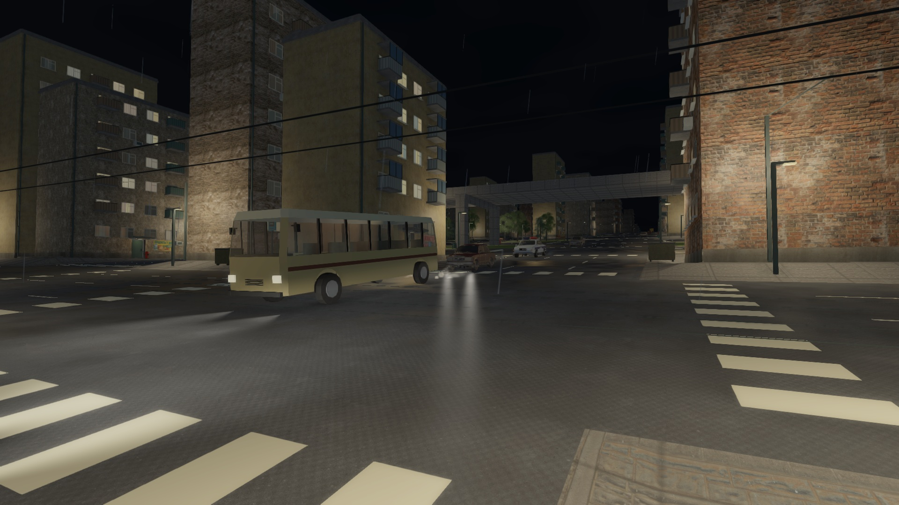

# PROMZONA

PROMZONA is an open-world game for Windows, Linux, and macOS set in a procedurally generated industrial city. Walk from the apartment blocks to the waterfront, catch a tram across town, or take a courier job and find your own way through traffic.



## Build and run

You'll need a graphics driver with OpenGL 3.3 support and git. The first CMake configure downloads and builds [SDL3](https://github.com/libsdl-org/SDL), which provides the window, input, and audio on every system.

### Windows

You'll need Windows x64 and Visual Studio with the **Desktop development with C++** workload, the Windows SDK, and **C++ CMake tools for Windows**. To build the game and launch it, run this from the repository root in PowerShell:

```powershell
.\build.ps1 -Configuration Debug -Run
```

To package a release:

```powershell
.\build.ps1 -Configuration Release -Package
.\artifacts\Release\Promzona.exe
```

The build script finds MSVC, compiles the game, runs CTest, and verifies the native x64 executable. To share a build, copy the entire `artifacts/Release` directory. The game loads models, shaders, textures, and audio from the `Content` folder next to the executable.

### Linux and macOS

You'll need CMake 3.25 or newer and a C++23 compiler: GCC 14 or newer, Clang 18 or newer, or Xcode 16 or newer on macOS. Ninja is used when installed. On Linux, SDL3 needs the X11 or Wayland and audio development packages, for example on Ubuntu:

```bash
sudo apt install build-essential cmake ninja-build libx11-dev libxext-dev libxrandr-dev libxcursor-dev libxi-dev libxss-dev libxkbcommon-dev libwayland-dev libegl-dev libgl-dev libasound2-dev libpulse-dev
```

To build, test, and launch the game:

```bash
./build.sh Debug --run
./build.sh Release --package
./artifacts/Release/Promzona
```

The `release` and `debug` CMake presets do the same without the script (`cmake --preset release`, `cmake --build --preset release`, `ctest --preset release`). To build against an SDL3 that is already installed, configure with `-DPROMZONA_SYSTEM_SDL3=ON`.

## Around the city

- **Districts.** A city seed determines the street grid, housing estates, courtyards, parks, garages, and factories. A freight line runs through the northern industrial district. On the coast, canals open into the sea. Five overpasses and four tunnels carry traffic between levels.
- **Traffic and public transport.** Drivers leave space beyond junctions and yield at pedestrian crossings. Buses pull in at stops. Trams and trolleybuses carry passengers on four routes. You can ride as a passenger or take the controls. A trolleybus loses power if you drive more than three metres from its route's overhead wires.
- **Work.** Pick up a parcel at a kiosk or open the job journal for vehicle deliveries, taxi fares, patient transport, and other assignments. On a passenger job, stop beside the person, press **E** to pick them up, and drive to the marked destination. A reconnaissance job takes you above the streets to inspect three rooftops by drone.
- **Garages and supplies.** Stop outside a garage and press **E** for repairs. During a pursuit, an extra $30 pays for a respray. Press **G** to buy a garage for $400, then use **G** on its forecourt to store a personal car or van. You can keep up to three vehicles. Food is available at kiosks and vending machines. At a market stall, press **E** on foot and use **1–4** to buy supplies.
- **Street life.** Pedestrians cross at signals, step around parked cars, and gather in groups. Emergency crews respond to incidents. Crimes can draw witnesses and police, with six wanted levels. Rain affects grip, tyre tracks, and spray, and the streets take several minutes to dry after a shower.

## Controls

Some keys have different functions on foot, in a vehicle, and in menus.

| On foot and on the road | Input |
| --- | --- |
| Walk, drive, or steer a scooter | W, A, S, D |
| Sprint on foot | Shift |
| Look around on foot or as a passenger | Mouse |
| Enter or leave a vehicle, mount or dismount a scooter, or buy food on foot | F |
| Apply the handbrake or brake a scooter | Space |
| Recover a vehicle | R |
| Fire the selected weapon or an armoured vehicle's turret | Left mouse button |
| Cycle weapons | Mouse wheel or the bracket keys |
| Cycle chase, overhead, and top-down cameras | V |
| Play the next radio track | M |
| Open the job journal and select an entry | J, then 1–8 |
| Start a three-contract series | J, then 8 |
| Pick up or deliver a job, board a fare, or operate a loudspeaker | E |

| Public transport and aircraft | Input |
| --- | --- |
| Board a stopped tram or trolleybus as a passenger | B |
| Get off at a stop or request the next stop | F or B |
| Drive a tram forward or in reverse | W / S |
| Launch or recall the drone while on foot | K |
| Ascend / descend in a helicopter or drone | Space or Q / Ctrl or Z |
| Inspect a marked rooftop from the drone | Left mouse button |
| Start or cancel a helicopter's automatic landing | L |

| Menus and shortcuts | Input |
| --- | --- |
| Navigate and confirm a menu selection | Up / Down, then Enter, or use the mouse |
| Select a save slot / load the selected slot in the menu | 1–3 / L |
| Change a setting | Left / Right |
| Quick save / quick load | F5 / F9 |
| Cycle display modes in the main or pause menu | F2 |
| Open the console / list its commands | F1 / `help` |
| Recall a command / complete it / scroll console output | Up or Down / Tab / Page Up or Page Down |
| Advance the clock by six hours / toggle rain | N / P |
| Open the pause menu or close the console | Esc |

## Saves, population, and language

The game keeps three save slots in `%LOCALAPPDATA%\PromzonaCpp` on Windows, `~/Library/Application Support/PromzonaCpp` on macOS, and `~/.local/share/PromzonaCpp` on Linux: `save.json`, `save-2.json`, and `save-3.json`. It autosaves to the active slot every two minutes of play, on pause, and on exit. Use the menu to save a copy in another slot.

Choose a population level in **Settings** when starting a city. A saved city keeps its own density when loaded.

| Population | Vehicles | Residents |
| --- | ---: | ---: |
| Low | 260 | 720 |
| Medium | 540 | 1,800 |
| High | 1,080 | 3,240 |
| Full (default) | 1,485 | 5,265 |

The interface supports English, Russian, and Ukrainian. On first launch, the game uses the system language when available. Change it in **Settings**. Language and population preferences are stored in `language.txt` and `density.txt` alongside the saves. For a single launch, pass `--language en`, `ru`, or `uk`, and `--density low`, `medium`, `high`, or `full`.

```powershell
.\artifacts\Release\Promzona.exe --language en --density medium
```

## Graphics

At night, street lamps and headlights illuminate the road. A passing bus can cast a shadow across a facade and appear in a nearby puddle. During the day, drifting clouds shade buildings and water. Apartment windows show room depth and curtains, while balconies, canopies, and drainpipes fade in as you approach. The renderer streams city blocks around the player. Draw distance is adjustable from 130 to 3,000 metres, with a default of 1,000 metres.

Press **F2** in the main or pause menu to cycle through the display modes. The selection is saved separately from the game.

| Mode | Rendering |
| --- | --- |
| Quality | Full-resolution scene with edge smoothing, bloom, and colour adjustments for weather and low sunlight |
| Balanced | Scene rendered at 75% of each screen dimension, with full-resolution UI and the same shadow-map resolution |
| Native | Full-resolution scene with post-processing disabled |

For technical details, see [city geometry and streaming](docs/ARCHITECTURE.md) and [lighting, weather, and vegetation](docs/ENVIRONMENT.md) (both in Russian).

## Development

The game uses C++23, OpenGL 3.3, and SDL3 for the window, input, and audio. Images are decoded with stb_image and the HUD text is drawn with stb_truetype. On Windows the HUD uses the system's Segoe UI and Arial; elsewhere it uses the bundled Liberation Sans from `Content/Fonts`. Code specific to the operating system lives in `src/platform_sdl.cpp`.

Open [Promzona.slnx](Promzona.slnx) in Visual Studio 2026, select **Debug | x64** or **Release | x64**, and press **F5** for a windowed debugging session. The project uses the v145 toolset and reads assets directly from the repository's `Content` directory. It takes SDL3 from [vcpkg.json](vcpkg.json) through Visual Studio's vcpkg integration (run `vcpkg integrate install` once if it is not enabled).

To generate a Visual Studio solution that also includes the libraries and tests, use CMake 4.2 or newer:

```powershell
.\create-vs2026.ps1 -Open
```

The generated solution lives in `build/vs2026`. Build the **RUN_TESTS** target to run the suite from Visual Studio. From Developer PowerShell, you can use the same presets directly:

```powershell
cmake --preset vs2026
cmake --build --preset vs2026-debug
ctest --preset vs2026-debug
```

Use `vs2026-release` for the Release build and test presets. When adding a game source file, include it in both the root Visual Studio project and its CMake target.

### Tests and visual checks

CTest covers city generation, vehicle physics, traffic, transit, pedestrians, jobs, emergency response, saves, localisation, asset loading, and audio. Rendering checks use a graphics desktop and the packaged game. Run the full smoke suite or capture a repeatable route:

```powershell
.\tools\smoke.ps1
.\tools\smoke.ps1 -VisualRoute rain -Scenarios night-crossing
.\tools\smoke.ps1 -VisualRoute clear -Scenarios bus-puddle,cloud-coast
```

The script writes logs and screenshots under `build/smoke`. Compare the same frame numbers across builds. For timing, run a separate GPU profile:

```powershell
.\artifacts\Release\Promzona.exe --smoke --gpu-profile --smoke-size 1920 1080 --scene-mode quality --quality 2 --scenario shadow-avenue --frames 421 --smoke-output build/bench-shadow
```

The profiler skips the first 60 frames. In `native.log`, `frame` reports whole-frame timing and `scene GPU` covers rendering from shadows through post-processing, before the HUD and window presentation. Both report the median and 95th percentile.

### Repository layout

| Path | Contents |
| --- | --- |
| [src](src), [include/promzona](include/promzona) | Game implementation and C++ headers |
| [Content](Content) | Models, textures, audio, and other runtime assets |
| [Content/Shaders/Native](Content/Shaders/Native) | GLSL shaders |
| [tests](tests) | Automated tests and reference data |
| [tools](tools) | Build verification and gameplay capture scripts |
| [docs](docs) | Technical documentation and screenshots |

## License

The project code is licensed under the [MIT License](LICENSE). Third-party libraries and game assets carry their respective notices. See [third-party credits](THIRD-PARTY.txt) and [asset credits](Content/IMPORTED-ASSET-CREDITS.txt).
